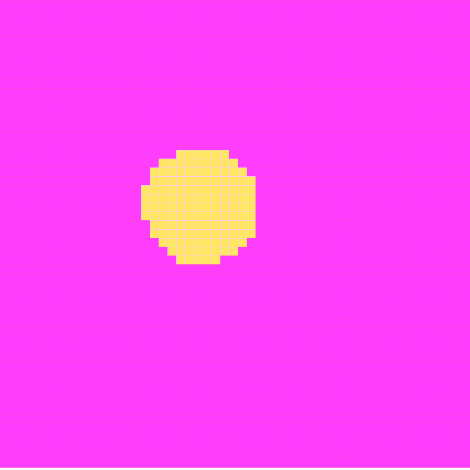

# sketch-p5.js

## Explicación
Sketch interactivo hecho con p5.js. 

## Interacción
- **Mover el ratón:** dibuja un círculo que sigue el cursor.
- **Clic c:** cambia el color del fondo.
- **Flecha arriba / abajo:** cambia el tamaño.
- **C a:** cambia el color del circulo del mouse.
- **S:** guarda una imagen.

## Vídeo
[Ver vídeo (5 s)](video.mov)

## Ver en p5.js
[Abrir el sketch en el editor de p5.js](https://editor.p5js.org/mariagraells/full/9jVXGM9MN)
